# WattNu

> Self-hosted three-phase energy monitoring — from DIN rail to SwiftUI, with
> historical data, Telegram and Apple push alerts, Grafana, and just enough
> Pieter humour.


WattNu reads an Eastron SDM630 energy meter every five seconds, stores the
measurements locally on a Raspberry Pi, and presents them in a native app for
iPhone, iPad, and Mac. A Grafana dashboard provides deeper analysis, while a
Telegram bot and Apple push notifications send alerts for sustained phase loads,
missing meter data, voltage or frequency excursions, and a configurable daily
energy limit.

The system is designed around local ownership of data: measurement history
stays on the Raspberry Pi. Only Telegram and Apple push notifications use
external internet services.

> [!WARNING]
> Work inside a distribution board must be performed by a qualified electrician.
> The software only reads the meter, but installing and wiring an SDM630 involves
> mains voltage and is not a do-it-yourself part of this project.

## Contents

- [Features](#features)
- [Screenshots](#screenshots)
- [System architecture](#system-architecture)
- [Technical design](#technical-design)
- [Hardware and software](#hardware-and-software)
- [Installing WattServer](#installing-wattserver)
- [Installing WattApp](#installing-wattapp)
- [Telegram notifications](#telegram-notifications)
- [Apple push notifications](#apple-push-notifications)
- [API](#api)
- [Data model and retention](#data-model-and-retention)
- [Security](#security)
- [Operations and maintenance](#operations-and-maintenance)
- [Testing](#testing)
- [Troubleshooting](#troubleshooting)
- [Known limitations](#known-limitations)
- [Possible next steps](#possible-next-steps)

## Features

### Native app

- Displays current total power, phase and neutral currents, voltage, frequency,
  and energy consumption.
- Refreshes the **Nu** screen every five seconds.
- Shows history for 1 hour, 24 hours, 7 days, and 30 days.
- Switches between current, power, and voltage charts.
- Visualises daily consumption per phase and an hour/weekday heatmap.
- Shows the highest one-minute peaks of the local electrical connection.
- Compares this week and month to date with the same stretch of the previous
  period and of last year.
- Shows feed-in per day, night-time standby load, and current THD.
- Converts own energy usage to euros with single or peak/off-peak kWh tariffs,
  optional feed-in tariff, and optional fixed daily costs, with overviews per
  day, week, month, and year plus CSV export.
- Includes small and medium WidgetKit widgets, plus lock-screen widgets on iOS.
  A widget without a connection shows the last known reading and its time.
- Receives Apple push notifications on iPhone, iPad, and Mac.
- Shares local settings between the app and widget through App Group
  `group.io.qman.wattnu`; the API token lives in the Keychain.
- Keeps alert preferences and tariffs on the server, so every device shows the
  same settings.
- Includes an optional **Pieter mode** with dry, context-aware comments.

### Self-hosted server

- Reads the SDM630 exclusively with Modbus function code 04.
- Samples the meter every five seconds through Telegraf.
- Buffers measurements while PostgreSQL is temporarily unavailable.
- Stores raw data and minute/hour aggregates in TimescaleDB.
- Automatically selects a suitable resolution for historical charts.
- Exposes a small FastAPI interface to the app, reading measurements through
  its own read-only database role.
- Ships with a provisioned Grafana dashboard.
- Evaluates alert rules every fifteen seconds.
- Applies versioned database migrations on every start.
- Writes a daily database backup and ships a restore test.

### Notifications

- A configurable current limit on L1, L2, or L3 (default 14 A), only after a
  configurable hold time (default one continuous minute).
- Separate detection for consumption and feed-in.
- Missing meter data.
- Voltage outside a configurable band (default 207–253 V) for one minute.
- Grid frequency outside 49.8–50.2 Hz for one minute.
- A daily kWh limit configured from WattApp.
- Deduplication and persistent notification state in SQLite.
- A test notification per channel, triggered from WattApp.

Alerts go to two independent channels: the Telegram Bot API and Apple Push
Notification service. Telegram needs no Apple account at all. Apple push needs
a paid Apple Developer Program membership and an APNs key on the Pi; the Pi
talks to Apple directly, so no extra server is involved.

## Screenshots

### Native app

The native interface is intended for quick day-to-day use. Its five tabs cover
live measurements, historical trends, consumption analysis, cost overviews per
day/week/month/year, and configuration.

<table>
  <tr>
    <th width="50%">Live dashboard</th>
    <th width="50%">Settings and alerts</th>
  </tr>
  <tr>
    <td>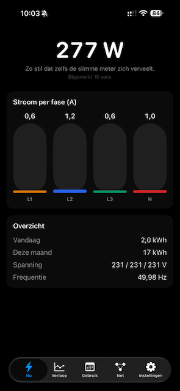</td>
    <td>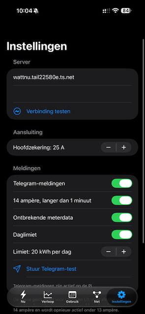</td>
  </tr>
</table>

<table>
  <tr>
    <th width="33%">Current history</th>
    <th width="33%">Power history</th>
    <th width="33%">Voltage history</th>
  </tr>
  <tr>
    <td>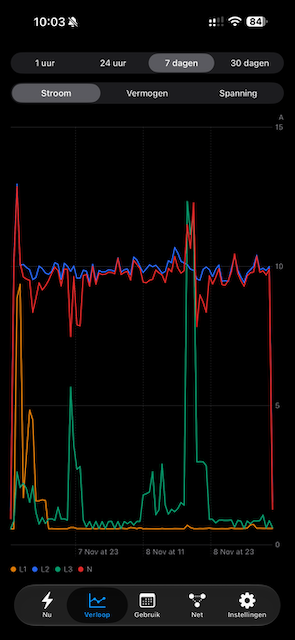</td>
    <td>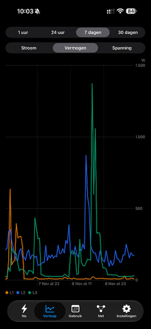</td>
    <td>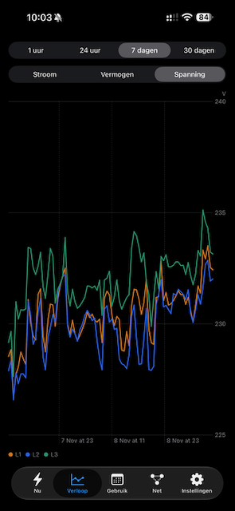</td>
  </tr>
</table>

### Grafana dashboard

Grafana provides the full technical view, including phase peaks, voltage,
phase distribution, and consumption patterns by hour and weekday.

<p align="center">
  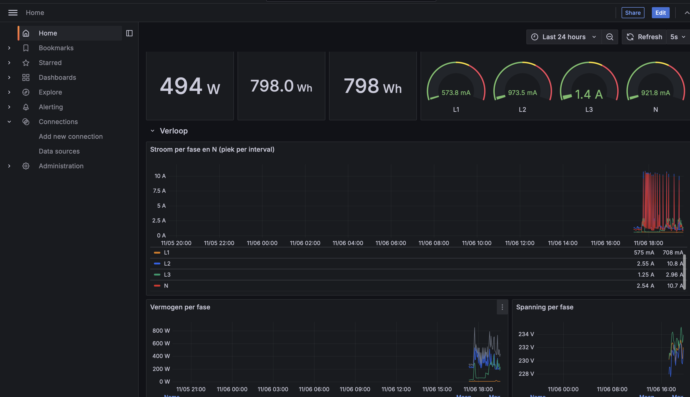
</p>

### Meter installation

<details>
<summary>View the installed Eastron SDM630-M</summary>

<p align="center">
  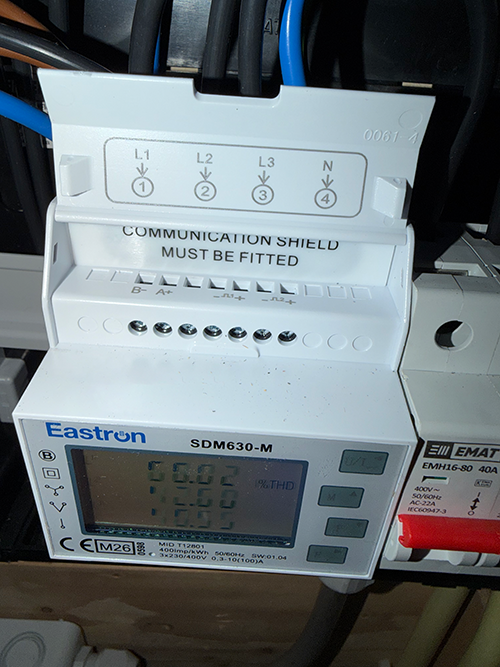
</p>

</details>

## System architecture

### Context diagram

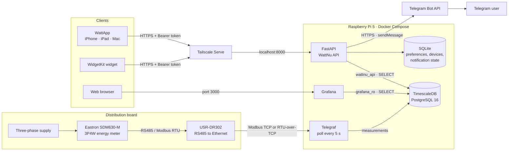

### Docker deployment

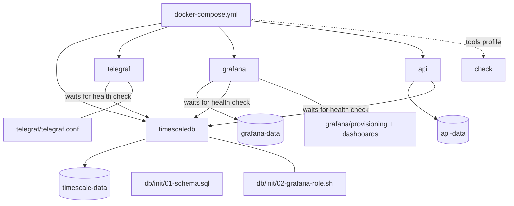

The database does not publish a host port. The API listens only on
`127.0.0.1:8000`; Tailscale Serve is the intended entry point for the app and
widget. Grafana also listens on loopback only, on port 3000, unless
`GRAFANA_BIND` says otherwise.

### Measurement data flow

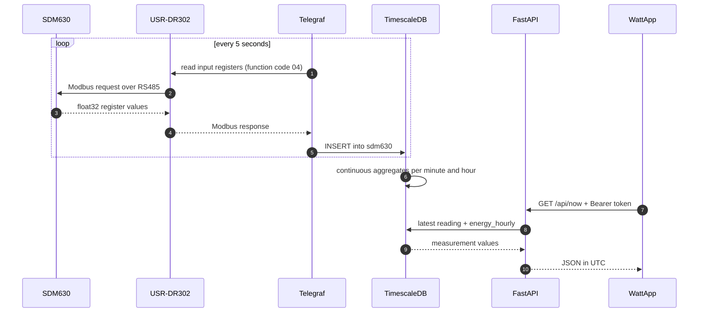

## Technical design

### Component responsibilities

| Component | Responsibility | Main design choice |
|---|---|---|
| SDM630 | Measures voltage, current, power, energy, and THD | Meter configured for 3P4W |
| USR-DR302 | Makes RS485 available over Ethernet | Modbus TCP or RTU-over-TCP |
| Telegraf | Polling, buffering, and database ingestion | 5 s interval, read-only |
| TimescaleDB | Time-series storage, aggregation, and retention | Hypertable + continuous aggregates |
| FastAPI | Small contract for app and notifications | Bearer token, no public OpenAPI |
| SQLite | Notification preferences and state | Persisted in `api-data` |
| Grafana | Operational and technical analysis | Provisioned and read-only by default |
| WattApp | Day-to-day user interface | SwiftUI + Swift Charts |
| Widget | Quick snapshot | Refreshes approximately every 15 min |
| Tailscale | Private access and TLS | API remains bound to loopback |

### Key design decisions

1. **The meter is authoritative for energy.** Hourly consumption is calculated
   from cumulative kWh counter readings. This is more accurate than numerically
   integrating power when individual samples are missing.
2. **Peaks remain visible.** Current values are aggregated using `max`, while
   power and voltage are averaged. Short current peaks are therefore not hidden
   by downsampling.
3. **Raw data has a bounded lifetime.** Five-second measurements are compressed
   after seven days and deleted after ninety days. Minute and hour aggregates
   are retained.
4. **The API is deliberately small.** It contains only the endpoints needed by
   the app. Swagger, ReDoc, and the OpenAPI endpoint are disabled in production.
5. **Database roles are separated.** Telegraf writes as `energy`; Grafana reads
   as `grafana_ro` and the API as `wattnu_api`, each with its own password.
6. **Notifications are server-side.** The Pi continues monitoring while WattApp
   is closed, and delivers alerts through Telegram, Apple push, or both.
7. **Shared preferences live on the server.** Alert settings and tariffs are
   read from and written to the Pi, so two devices cannot overwrite each other
   with stale local copies.
8. **Timestamps are exchanged in UTC.** Day, week, month, and year boundaries
   are calculated explicitly in SQL using `Europe/Amsterdam`.

### Time-series resolution

The SQL function `energy_series(from, to, step_ms)` selects the source based on
the requested period:

| Requested period | Source | Minimum bucket |
|---|---|---:|
| up to 6 hours and newer than 89 days | `sdm630` | 5 seconds |
| over 6 hours, up to 14 days | `sdm630_1m` | 1 minute |
| longer than 14 days | `sdm630_1h` | 1 hour |

The API requests approximately 300 points by default. The resulting step size
is the larger of the desired chart interval and the minimum bucket of the
selected source.

### Energy-flow direction

The SDM630 current registers contain absolute values. WattNu derives the
direction of each phase from the sign of `power_l1`, `power_l2`, and `power_l3`:

- positive phase power: consumption/import;
- negative phase power: feed-in/export.

This is also the basis for separate alerts for consumption and feed-in.

### Repository structure

```text
.
├── README.md
├── images/                         # app, dashboard, and hardware images
├── WattApp/
│   ├── App/                        # SwiftUI screens and app entry point
│   ├── Shared/                     # API client, models, settings, styling
│   ├── Widget/                     # WidgetKit extension
│   ├── Config/                     # Info.plist files and entitlements
│   └── WattNu.xcodeproj/
└── WattServer/
    ├── api/
    │   ├── main.py                 # FastAPI routes
    │   ├── notifications.py        # alert rules, preferences, deduplication
    │   ├── telegram.py             # Telegram channel
    │   ├── apns.py                 # Apple push channel
    │   ├── migrate.py              # migration runner and API database role
    │   └── tests/                  # unit tests
    ├── db/init/                    # base schema, first start only
    ├── db/migrations/              # numbered schema changes after that
    ├── grafana/                    # provisioning and dashboard as code
    ├── telegraf/telegraf.conf      # Modbus registers and PostgreSQL output
    ├── tools/check_meter.py        # read-only connection test
    ├── tools/backup.sh             # daily pg_dump, run by the backup service
    ├── tools/restore-test.sh       # restores the latest dump into a scratch database
    ├── secrets/                    # APNs key (.p8), not committed
    ├── backups/                    # database dumps, not committed
    ├── .env.example
    └── docker-compose.yml
```

## Hardware and software

### Reference hardware

- Eastron SDM630-M configured for **3P4W**;
- USR-DR302 RS485-to-Ethernet gateway;
- Raspberry Pi 5 running 64-bit Linux;
- reliable database storage;
- a wired or stable wireless local network;
- iPhone/iPad with iOS 17+, or a Mac with macOS 14+.

The server can also run on another Docker host, provided it can reach the
USR-DR302 over the network.

### Required software

- Git;
- Docker Engine with Docker Compose v2;
- optionally Tailscale on the Pi and Apple devices;
- Xcode for building WattApp;
- a Telegram account for notifications.

The Compose stack currently uses TimescaleDB `2.17.2-pg16`, Telegraf `1.32`,
Grafana `11.3.0`, and Python `3.12` with FastAPI, Uvicorn, psycopg, and httpx.

## Installing WattServer

### 1. Clone the repository

```bash
git clone https://github.com/pieterleek/EnergieApp-WattNu.git
cd EnergieApp-WattNu/WattServer
```

### 2. Configure the environment

```bash
cp .env.example .env
```

Configure at least:

```dotenv
POSTGRES_PASSWORD='a-long-unique-password'
GRAFANA_DB_PASSWORD='another-long-unique-password'
GRAFANA_ADMIN_PASSWORD='yet-another-long-unique-password'
API_DB_PASSWORD='a-fourth-long-unique-password'
GRAFANA_BIND=127.0.0.1

MODBUS_HOST=192.168.1.100
MODBUS_PORT=502
MODBUS_MODE=TCP
MODBUS_SLAVE=1

API_TOKEN='a-long-random-token'
API_PORT=8000

TELEGRAM_BOT_TOKEN=
TELEGRAM_CHAT_ID=

APNS_KEY_FILE=/secrets/AuthKey_XXXXXXXXXX.p8
APNS_KEY_ID=
APNS_TEAM_ID=
APNS_BUNDLE_ID=io.qman.wattnu

BACKUP_KEEP_DAYS=7
```

`API_DB_PASSWORD` is the password of the API's own read-only role. Leaving it
unset falls back to `GRAFANA_DB_PASSWORD`, so an existing installation keeps
working after an update.

Generate safe hexadecimal secrets with:

```bash
openssl rand -hex 32
```

> [!IMPORTANT]
> Wrap values containing `$` in single quotes. Docker Compose interpolates
> unquoted and double-quoted values. Without quotes, `variable is not set`
> warnings may appear and a password can silently change.

Validate the configuration without printing resolved secrets:

```bash
docker compose config --quiet
```

### 3. Test Modbus

```bash
docker compose run --rm check
```

The tool tries `TCP` and `RTUoverTCP`, reads only a limited set of registers,
and reports the required `MODBUS_MODE`. If the meter does not respond, check:

- DR302 IP address and TCP port;
- SDM630 Modbus address;
- baud rate, parity, and stop bits at both RS485 endpoints;
- A/B polarity;
- the SDM630 3P4W setting.

If the meter address is not 1, set `MODBUS_SLAVE` in `.env`; both Telegraf and
the connection test read it from there.

### 4. Start the stack

```bash
docker compose up -d --build
docker compose ps
```

On first start:

1. PostgreSQL initialises database `energy`;
2. TimescaleDB is enabled;
3. the hypertable, aggregates, view, and SQL function are created;
4. `grafana_ro` is created with read-only permissions;
5. the `migrate` service applies pending migrations and creates the read-only
   `wattnu_api` role;
6. Telegraf, Grafana, and the API start after the health check passes.

Initialisation scripts in `db/init/` run only when `timescale-data` is empty.
Later schema changes go into `db/migrations/` as numbered SQL files; `migrate`
runs on every start and applies the ones not yet recorded in
`schema_migrations`. See `WattServer/db/migrations/README.md`.

### 5. Verify the installation

```bash
docker compose logs --tail 50 timescaledb
docker compose logs --tail 50 telegraf
docker compose logs --tail 50 api
```

Inspect the latest reading:

```bash
docker compose exec timescaledb \
  psql -U energy -d energy \
  -c "SELECT time, power_total, current_l1, current_l2, current_l3, current_n FROM sdm630 ORDER BY time DESC LIMIT 1;"
```

Grafana listens on loopback only by default. Reach it with
`sudo tailscale serve --bg --https 8443 3000`, or set `GRAFANA_BIND=0.0.0.0` in
`.env` to make it available at `http://<raspberry-pi-address>:3000` on the
whole network. Log in as `admin` with `GRAFANA_ADMIN_PASSWORD`.

### 6. Private HTTPS access

The API is bound to loopback. Expose it inside the private tailnet with:

```bash
sudo tailscale serve --bg 8000
tailscale serve status
```

Tailscale reports an address such as:

```text
https://wattnu.<your-tailnet>.ts.net/
```

Enter only the host name in WattApp; the app adds `/api`. Use **Tailscale
Serve**, not Funnel: this API is not intended for the public internet.

## Installing WattApp

1. Open `WattApp/WattNu.xcodeproj` in Xcode.
2. Select your Signing Team for the app and widget targets.
3. For a fork, choose unique bundle identifiers and update the App Group in
   `AppSettings.swift` and all four entitlement files.
4. Build the **WattNu** scheme for iPhone, iPad, or Mac.
5. Enter the Tailscale host name, `API_TOKEN`, and your main fuse rating.
6. Select **Verbinding testen** to test the connection.

| Component | Identifier |
|---|---|
| App | `io.qman.wattnu` |
| Widget | `io.qman.wattnu.widget` |
| App Group | `group.io.qman.wattnu` |

Valid Xcode signing is required for a physical Apple device. The app target
declares the Push Notifications capability, which is only available with a paid
Apple Developer Program membership. With a free personal team, remove
`aps-environment` from `Config/App-iOS.entitlements` and
`com.apple.developer.aps-environment` from `Config/App-macOS.entitlements`;
everything except Apple push keeps working, including Telegram.

The API token is stored in the Keychain and shared with the widget through the
`keychain-access-groups` entitlement. A token saved by an older version in the
App Group preferences is moved to the Keychain on first launch.

## Telegram notifications

### Create a bot

1. Open [@BotFather](https://t.me/BotFather).
2. Send `/newbot` and follow the instructions.
3. Send the new bot a message yourself, for example `start`.
4. Retrieve updates:

   ```bash
   curl -s "https://api.telegram.org/bot<BOT_TOKEN>/getUpdates"
   ```

5. Find `message.chat.id`. Use your conversation's numeric chat ID, not the bot
   ID or username.
6. Add both values to `.env`:

   ```dotenv
   TELEGRAM_BOT_TOKEN='123456789:AA...'
   TELEGRAM_CHAT_ID='123456789'
   ```

7. Rebuild the API:

   ```bash
   docker compose up -d --build api
   docker compose logs --tail 50 api
   ```

Enable the desired alerts under **Instellingen** in WattApp and send a test.

### Phase-alert state machine

The diagram shows the defaults: a 14 A limit and a 60 s hold time. Both are
configurable under **Instellingen**; the reset threshold is always 1 A below the
limit.

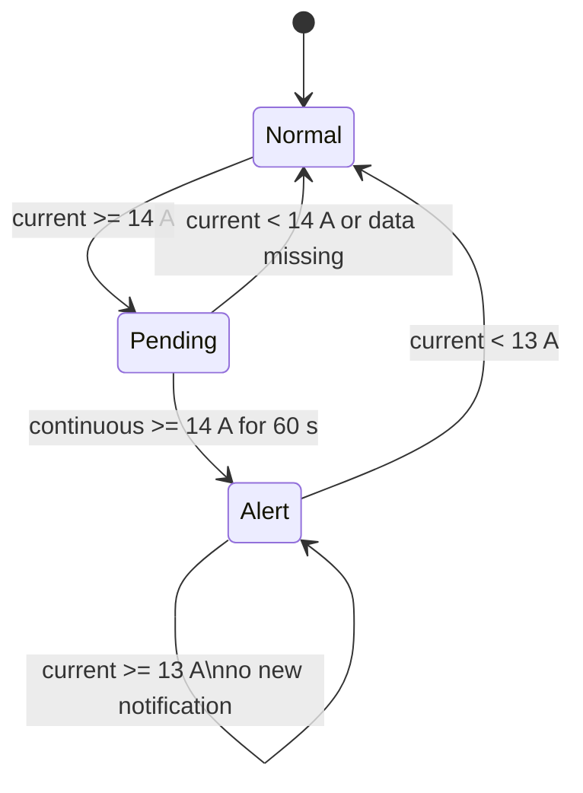

The hysteresis prevents repeated alerts around the threshold. A successful alert
is not repeated while its state is active. An alert counts as delivered when at
least one channel accepted it; if every channel fails, it is retried no earlier
than five minutes later.

| Alert | Condition | Reset / deduplication |
|---|---|---|
| Phase consumption | phase ≥ limit for the hold time and positive phase power | rearmed 1 A below the limit |
| Phase feed-in | phase ≥ limit for the hold time and negative phase power | rearmed 1 A below the limit |
| Missing data | latest reading older than 60 s | reset when data is fresh |
| Voltage | a phase outside the configured band for 60 s | rearmed 2 V inside the band |
| Frequency | outside 49.8–50.2 Hz for 60 s | rearmed 0.05 Hz inside the band |
| Daily limit | today's consumption ≥ configured kWh | at most once per local day |

Voltage and frequency alerts are off by default. Current THD is shown in the app
but has no alert: at low load it is routinely above 100 % and says little.

Preferences, registered devices, and alert state are stored in
`notifications.sqlite3` in the `api-data` volume, so an API restart does not
clear them.

## Apple push notifications

The Pi sends alerts straight to Apple Push Notification service (APNs) with
token authentication. This needs a paid Apple Developer Program membership.

### Create an APNs key

1. In the [Apple Developer portal](https://developer.apple.com/account/resources/authkeys/list),
   create a key with **Apple Push Notifications service (APNs)** enabled.
2. Download the `AuthKey_<KEY_ID>.p8` file. Apple offers it only once.
3. Copy it to `WattServer/secrets/` on the Pi and make it readable for the API
   container, which runs as an unprivileged user:

   ```bash
   chmod 644 secrets/AuthKey_<KEY_ID>.p8
   ```

4. Add the values to `.env`. The Team ID is on the Membership page of the
   developer portal:

   ```dotenv
   APNS_KEY_FILE=/secrets/AuthKey_<KEY_ID>.p8
   APNS_KEY_ID=<KEY_ID>
   APNS_TEAM_ID=<TEAM_ID>
   APNS_BUNDLE_ID=io.qman.wattnu
   ```

5. Restart the API and check the log for an APNs warning:

   ```bash
   docker compose up -d --build api
   docker compose logs --tail 50 api
   ```

The `secrets/` directory is ignored by Git. One key works for iOS and macOS and
for both the sandbox and production APNs environments.

### Register a device

In WattApp, open **Instellingen**, switch on **Pushmeldingen op dit apparaat**,
allow notifications, and choose **Stuur pushtest**. Repeat on every device.

A build started from Xcode registers with the APNs sandbox; TestFlight and App
Store builds use production. The app reports its environment and the server
routes each device accordingly. Tokens that Apple reports as expired are
removed automatically.

The Pi needs outbound HTTPS (HTTP/2) to `api.push.apple.com` and
`api.sandbox.push.apple.com`.

## API

Every route except `/api/health` requires:

```http
Authorization: Bearer <API_TOKEN>
```

Timestamps are ISO 8601 UTC. Database values are rounded to three decimal places
for JSON responses.

| Method | Route | Parameters | Purpose |
|---|---|---|---|
| `GET` | `/api/now` | – | latest reading, today, month, stale state |
| `GET` | `/api/series` | `hours=1..8784`, `points=10..1000` | downsampled history |
| `GET` | `/api/daily` | `days=1..3660` | daily total, feed-in, and per-phase use |
| `GET` | `/api/heatmap` | `days=7..3660` | average kWh by weekday/hour |
| `GET` | `/api/peaks` | `days=1..3660`, `limit=1..50` | one-minute peaks |
| `GET` | `/api/baseload` | `days=1..366` | night-time standby load per day |
| `GET` | `/api/compare` | – | week and month to date against the previous period |
| `GET` | `/api/costs` | `period=day\|week\|month\|year`, `count=1..366` | own usage and estimated costs per period |
| `GET` | `/api/settings` | – | shared preferences and configured channels |
| `PUT` | `/api/settings` | JSON body | replace the shared preferences |
| `POST` | `/api/devices` | JSON body | register a device for Apple push |
| `DELETE` | `/api/devices/{token}` | – | unregister a device |
| `POST` | `/api/notifications/test` | `channel=telegram\|push` (optional) | send a test notification |
| `GET` | `/api/health` | – | database reachable; no token, no data |

`PUT /api/telegram/settings` and `POST /api/telegram/test` remain for app
versions from before the shared settings.

`/api/baseload` takes the 10th percentile of the one-minute average power
between 00:00 and 05:00 local time; nights with less than an hour of data are
left out.

Example:

```bash
curl -s \
  -H "Authorization: Bearer <API_TOKEN>" \
  "http://127.0.0.1:8000/api/now"
```

Settings example. The body replaces all preferences; omitted fields return to
their defaults, and an omitted `daily_limit_kwh` or tariff is cleared:

```bash
curl -s -X PUT \
  -H "Authorization: Bearer <API_TOKEN>" \
  -H "Content-Type: application/json" \
  -d '{
    "enabled": true,
    "telegram_enabled": true,
    "push_enabled": true,
    "phase_alerts": true,
    "phase_limit_amps": 14,
    "phase_hold_seconds": 60,
    "stale_alerts": true,
    "daily_limit_kwh": 20,
    "voltage_alerts": false,
    "voltage_min": 207,
    "voltage_max": 253,
    "frequency_alerts": false,
    "pieter_mode": true,
    "price_import": 0.28,
    "price_export": 0.07
  }' \
  "http://127.0.0.1:8000/api/settings"
```

## Data model and retention

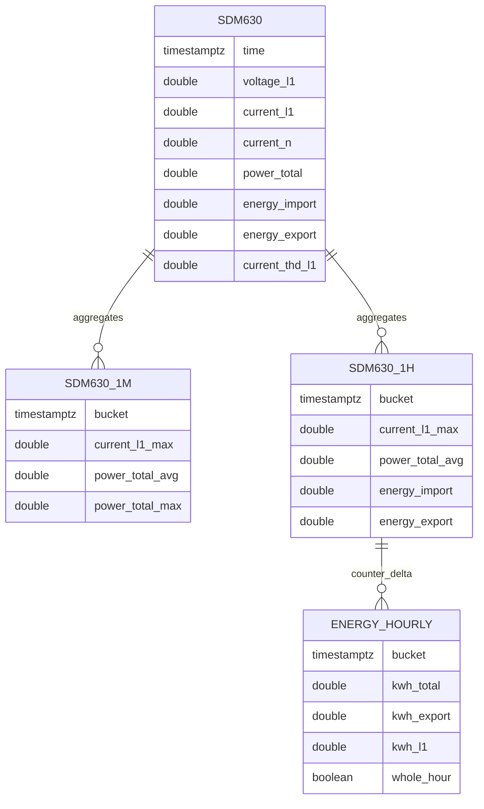

| Object | Grain | Contents | Retention |
|---|---:|---|---|
| `sdm630` | 5 s | all raw register measurements | 90 days |
| `sdm630_1m` | 1 min | averages and current/power peaks | unlimited |
| `sdm630_1h` | 1 hour | averages, peaks, latest counters | unlimited |
| `energy_hourly` | 1 hour | import/export and phase-import deltas | unlimited view |

Raw chunks are compressed after seven days. The minute aggregate refreshes each
minute with a six-hour lookback. The hour aggregate refreshes every thirty
minutes with a two-day lookback.

`whole_hour` is true only when consecutive readings are exactly one hour apart.
Incomplete periods count in totals but not in the hour/weekday heatmap. A
decreasing counter after meter replacement or reset is treated as zero using
`greatest(delta, 0)`.

### Measured registers

WattNu stores voltage on all phases; current on L1, L2, L3, and N; phase and
total power; frequency; total import/export; import per phase; and current THD
per phase.

Neutral current comes from protocol address `0x00E0` (register 30225). For
critical use, compare it with a suitable true-RMS clamp meter, especially with
non-linear loads.

## Security

### Trust boundaries

| Boundary | Control | Remaining risk |
|---|---|---|
| App → API | Tailscale HTTPS + Bearer token | one token, no user roles |
| API → database | read-only `wattnu_api`, own password | can read all measurements |
| Grafana → database | read-only role | admin can read all data |
| Telegraf → meter | function code 04 only | Modbus has no authentication |
| API → Telegram | outbound HTTPS | bot token controls the bot |
| API → APNs | outbound HTTPS, short-lived signed token | `.p8` key can push to the app |
| Docker → API | `/api/health` without token | reveals only that the database answers |

Current controls include an unpublished database port, loopback-only API port,
loopback-only Grafana port, constant-time token comparison, disabled OpenAPI
documentation, disabled Grafana signup, separate read-only query roles,
secret-safe Telegram and APNs logging, ignored `.env`, `secrets/`, and
`backups/`, the API token in the Keychain, and App Sandbox on macOS.

Recommended hardening:

- place the meter, gateway, and Pi on a trusted LAN or VLAN;
- expose Grafana only over Tailscale, or over the LAN if you must;
- give `API_DB_PASSWORD` its own value instead of the Grafana fallback;
- use unique long secrets and never share resolved Compose output;
- revoke leaked Telegram tokens and APNs keys immediately;
- copy the dumps in `backups/` to another machine, encrypted: they sit
  unencrypted on the same disk as the database.

## Operations and maintenance

### Status and logs

```bash
docker compose ps
docker compose logs --tail 100 timescaledb
docker compose logs --tail 100 telegraf
docker compose logs --tail 100 api
docker compose logs --tail 100 grafana
```

### Update the API

```bash
git pull
docker compose up -d --build api
```

### Update the stack

```bash
git pull
docker compose pull
docker compose up -d --build
```

Consult official migration instructions before upgrading PostgreSQL or
TimescaleDB. A new image tag is not automatically a valid major-version upgrade
for an existing volume.

### Database backup

The `backup` service writes `backups/wattnu-<date>.dump` once a day and removes
dumps older than `BACKUP_KEEP_DAYS` (default 7). A dump is written to a
temporary file first, so a file named `wattnu-*.dump` is always complete.

```bash
docker compose logs --tail 20 backup
ls -lh backups/
```

Test a restore. This loads the newest dump into a throwaway container, counts
the measurements, and leaves the real database alone:

```bash
./tools/restore-test.sh
```

The dumps live on the same disk as the database. Copy them elsewhere for a real
backup. A manual dump still works:

```bash
docker compose exec -T timescaledb \
  pg_dump -U energy -d energy -Fc > wattnu-$(date +%F).dump
```

### Health

```bash
docker compose ps api
curl -s http://127.0.0.1:8000/api/health
```

The API container reports `healthy` while it can reach the database.

### Storage usage

```bash
docker system df
docker compose exec timescaledb \
  psql -U energy -d energy \
  -c "SELECT pg_size_pretty(total_bytes) AS total FROM hypertable_detailed_size('sdm630');"
```

### Grafana dashboard as code

The dashboard is provisioned from `grafana/dashboards/wattnu.json` with
`allowUiUpdates: false`, `disableDeletion: true`, datasource UID `wattnu-db`,
and dashboard title `WattNu`.

You can temporarily enable UI updates for experiments, but durable changes
should be written back to JSON so the repository remains the source of truth.

## Testing

### Server tests

```bash
cd WattServer
docker compose build api
docker run --rm --entrypoint python \
  -v "$PWD/api:/tests:ro" \
  -w /tests wattserver-api:latest \
  -m unittest discover -s tests -v
```

Tests cover flow direction, the configurable limit and hold time, the reset
below the limit, short-peak cancellation, voltage and frequency bands,
delivery per channel, notification deduplication and retry, SQLite migration,
Telegram escaping/chat targeting, APNs signing, routing and expired devices,
API authentication, settings, device registration, and cost calculations.

The SQL behind the measurement endpoints is not covered by unit tests; it needs
a TimescaleDB instance.

### Continuous integration

`.github/workflows/server.yml` runs the server tests, validates the Compose
file, and builds the API image. `.github/workflows/app.yml` builds the app for
iOS and macOS without signing. Each runs only when its own directory changes.

### Swift builds without signing

```bash
xcodebuild \
  -project WattApp/WattNu.xcodeproj \
  -scheme WattNu \
  -sdk iphonesimulator \
  CODE_SIGNING_ALLOWED=NO build
```

```bash
xcodebuild \
  -project WattApp/WattNu.xcodeproj \
  -scheme WattNu \
  -sdk macosx \
  CODE_SIGNING_ALLOWED=NO build
```

## Troubleshooting

### Compose reports `variable is not set`

A password probably contains `$`. Wrap it in single quotes:

```dotenv
GRAFANA_DB_PASSWORD='value-containing-$-characters'
```

```bash
docker compose config --quiet
docker compose up -d --force-recreate api grafana
```

### API reports `PoolTimeout`

```bash
docker compose ps
docker compose logs --tail 100 timescaledb
docker compose logs --tail 100 api
docker compose exec timescaledb \
  psql -U energy -d energy \
  -c "SELECT rolname, rolcanlogin FROM pg_roles WHERE rolname = 'grafana_ro';"
```

If the role is missing, the init scripts were not rerun for the existing
volume. Recreate the role deliberately; do not delete useful history.

### `relation sdm630_1h does not exist`

Schema initialisation did not complete. Inspect the first database error, not
only the last follow-up error. A full reset is suitable only for a disposable
test environment. Back up valuable history before repairing a schema.

### API starts before the database

Brief `database system is starting up` messages can occur during recovery. The
health check and restart policy should stabilise the stack. Persistent password
errors indicate role/configuration mismatch, not an underpowered Pi.

### Missing cgroup file during Timescale tuning

Compose sets `NO_TS_TUNE: "true"`, preventing automatic tuning from relying on
cgroup files that may be absent on some Pi installations.

### No meter data

```bash
docker compose run --rm check
docker compose logs --tail 100 telegraf
```

Also verify Pi time and DR302 reachability from the Docker host network.

### Telegram: `chat not found`

- Send the bot a message first.
- Retrieve `getUpdates` afterwards.
- Use `message.chat.id`, not the bot ID.
- Rebuild the API after changing `.env`.

### Telegram: `the bot can't send messages to the bot`

The configured ID belongs to the bot itself. Replace it with the conversation
ID between your Telegram account and the bot.

### WattApp reports `401`

The app token does not exactly match `API_TOKEN`. Check whitespace and recreate
the API after changing it:

```bash
docker compose up -d --force-recreate api
```

### WattApp cannot reach the API

```bash
tailscale serve status
curl -s -o /dev/null -w '%{http_code}\n' \
  -H "Authorization: Bearer <API_TOKEN>" \
  https://<host>.<tailnet>.ts.net/api/now
```

Both devices must be in the same tailnet. Do not add a second `/api` path to the
server address in WattApp.

### Complete test-environment reset

> [!CAUTION]
> This permanently removes database, Grafana, and notification volumes. Use it
> only when all history may be deleted and a usable backup exists.

```bash
docker compose down -v
docker compose up -d --build
```

## Known limitations

- WattNu is a personal project, not a certified safety or billing system.
- The API uses one shared Bearer token and has no user management.
- Notifications do not replace electrical protection.
- Costs support single or peak/off-peak kWh tariffs, feed-in tariff, and fixed
  daily charges, but do not fetch dynamic hourly market prices.
- Apple push needs a paid Apple Developer Program membership.
- There is no Live Activity; lock-screen widgets refresh on the system's
  schedule, roughly every fifteen minutes.
- The app is Dutch only.
- Backups are unencrypted and stay on the Pi unless you copy them.
- Screenshots may be slightly behind the latest tab layout.

## Possible next steps

- token rotation;
- price data for dynamic energy contracts;
- a Live Activity during sustained high load;
- localisation;
- off-site, encrypted backups;
- a metrics endpoint;
- automatically refreshed release screenshots.

## Technology and references

- [Eastron SDM630](https://www.eastroneurope.com/products/view/sdm630modbus)
- [Telegraf Modbus input](https://github.com/influxdata/telegraf/tree/master/plugins/inputs/modbus)
- [TimescaleDB](https://docs.timescale.com/)
- [Grafana](https://grafana.com/docs/grafana/latest/)
- [FastAPI](https://fastapi.tiangolo.com/)
- [Tailscale Serve](https://tailscale.com/docs/reference/tailscale-cli/serve)
- [Telegram Bot API](https://core.telegram.org/bots/api)
- [SwiftUI](https://developer.apple.com/xcode/swiftui/)
- [Swift Charts](https://developer.apple.com/documentation/charts)

## Licence

This repository currently has no separate `LICENSE` file. Add an explicit
licence before inviting public reuse; without one, reuse rights are not granted
automatically.

---

**WattNu** — measuring is knowing, and charts are just opinions with a legend.
