# WattNu

> Self-hosted three-phase energy monitoring — from DIN rail to SwiftUI, with
> historical data, Telegram alerts, Grafana, and just enough Pieter humour.


WattNu reads an Eastron SDM630 energy meter every five seconds, stores the
measurements locally on a Raspberry Pi, and presents them in a native app for
iPhone, iPad, and Mac. A Grafana dashboard provides deeper analysis, while a
Telegram bot sends alerts for sustained phase loads, missing meter data, and a
configurable daily energy limit.

The system is designed around local ownership of data: measurement history
stays on the Raspberry Pi. Only Telegram notifications and the optional Dutch
national grid-load feature use external internet services.

> [!WARNING]
> Work inside a distribution board must be performed by a qualified electrician.
> The software only reads the meter, but installing and wiring an SDM630 involves
> mains voltage and is not a do-it-yourself part of this project.

## Contents

- [Features](#features)
- [Screenshots](#screenshots)
- [System architecture](#system-architecture)
- [Technical design](#technical-design)
- [Hardware and software](#hardware-and-software)
- [Installing WattServer](#installing-wattserver)
- [Installing WattApp](#installing-wattapp)
- [Telegram notifications](#telegram-notifications)
- [API](#api)
- [Data model and retention](#data-model-and-retention)
- [Security](#security)
- [Operations and maintenance](#operations-and-maintenance)
- [Testing](#testing)
- [Troubleshooting](#troubleshooting)
- [Known limitations](#known-limitations)
- [Possible next steps](#possible-next-steps)

## Features

### Native app

- Displays current total power, phase and neutral currents, voltage, frequency,
  and energy consumption.
- Refreshes the **Nu** screen every five seconds.
- Shows history for 1 hour, 24 hours, 7 days, and 30 days.
- Switches between current, power, and voltage charts.
- Visualises daily consumption per phase and an hour/weekday heatmap.
- Shows the highest one-minute peaks of the local electrical connection.
- Shows total Dutch national grid load for 24 hours, 7 days, or 30 days.
- Includes small and medium WidgetKit widgets.
- Shares settings between the app and widget through App Group
  `group.io.qman.wattnu`.
- Includes an optional **Pieter mode** with dry, context-aware comments.

### Self-hosted server

- Reads the SDM630 exclusively with Modbus function code 04.
- Samples the meter every five seconds through Telegraf.
- Buffers measurements while PostgreSQL is temporarily unavailable.
- Stores raw data and minute/hour aggregates in TimescaleDB.
- Automatically selects a suitable resolution for historical charts.
- Exposes a small read-only FastAPI interface to the app.
- Ships with a provisioned Grafana dashboard.
- Evaluates Telegram rules every fifteen seconds.
- Retrieves Dutch grid load from Energy-Charts and caches it for fifteen
  minutes.

### Notifications

- 14 amperes or more on L1, L2, or L3, only after one continuous minute.
- Separate detection for consumption and feed-in.
- Missing meter data.
- A daily kWh limit configured from WattApp.
- Deduplication and persistent notification state in SQLite.
- A test notification triggered from WattApp.

WattNu uses the Telegram Bot API for these notifications. It therefore does not
need a paid Apple Developer Program membership or an APNs server to deliver
alerts.

## Screenshots

### Native app

The native interface is intended for quick day-to-day use. Its five tabs cover
live measurements, historical trends, consumption analysis, Dutch national grid
load, and configuration.

<table>
  <tr>
    <th width="33%">Live dashboard</th>
    <th width="33%">Dutch grid load</th>
    <th width="33%">Settings and alerts</th>
  </tr>
  <tr>
    <td>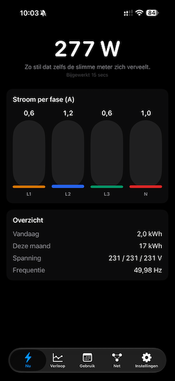</td>
    <td>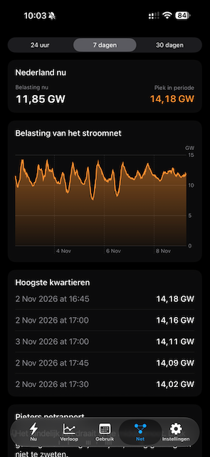</td>
    <td>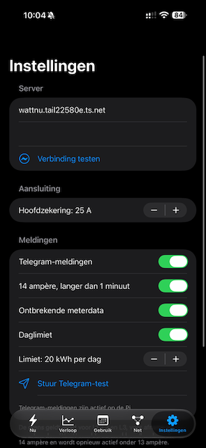</td>
  </tr>
  <tr>
    <th>Current history</th>
    <th>Power history</th>
    <th>Voltage history</th>
  </tr>
  <tr>
    <td>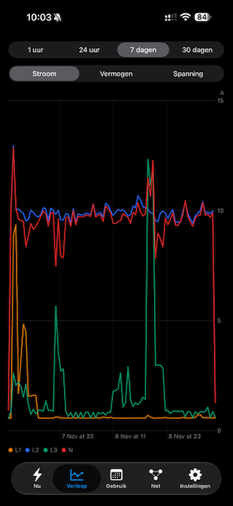</td>
    <td>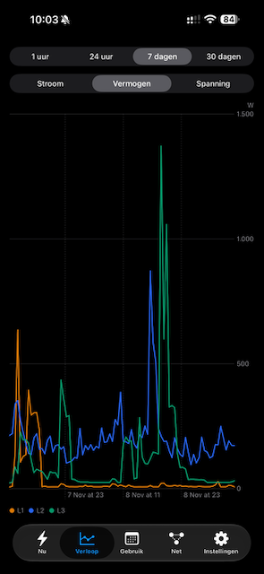</td>
    <td>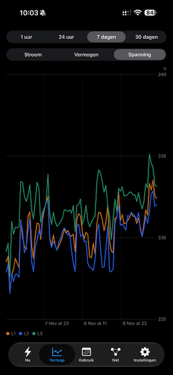</td>
  </tr>
</table>

### Grafana dashboard

Grafana provides the full technical view, including phase peaks, voltage,
phase distribution, and consumption patterns by hour and weekday.

<p align="center">
  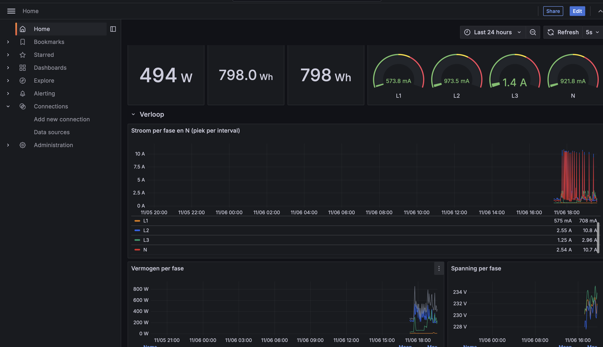
</p>

### Meter installation

<details>
<summary>View the installed Eastron SDM630-M</summary>

<p align="center">
  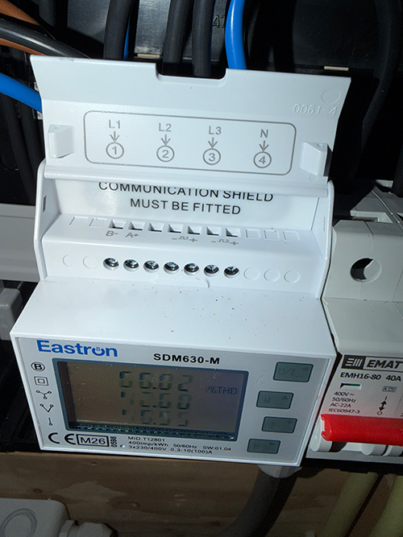
</p>

</details>

## System architecture

### Context diagram

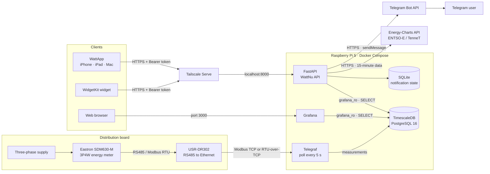

### Docker deployment

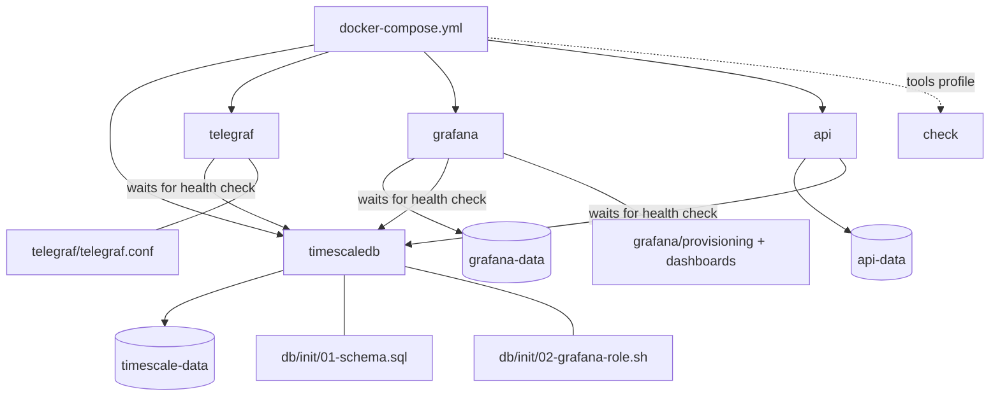

The database does not publish a host port. The API listens only on
`127.0.0.1:8000`; Tailscale Serve is the intended entry point for the app and
widget. Grafana publishes port 3000 on the host by default.

### Measurement data flow

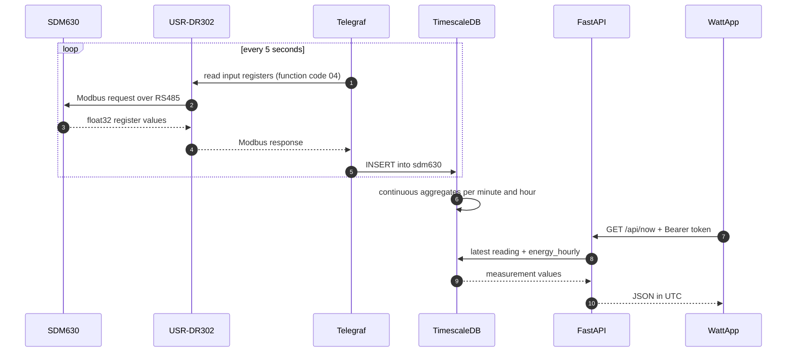

## Technical design

### Component responsibilities

| Component | Responsibility | Main design choice |
|---|---|---|
| SDM630 | Measures voltage, current, power, energy, and THD | Meter configured for 3P4W |
| USR-DR302 | Makes RS485 available over Ethernet | Modbus TCP or RTU-over-TCP |
| Telegraf | Polling, buffering, and database ingestion | 5 s interval, read-only |
| TimescaleDB | Time-series storage, aggregation, and retention | Hypertable + continuous aggregates |
| FastAPI | Small contract for app and notifications | Bearer token, no public OpenAPI |
| SQLite | Notification preferences and state | Persisted in `api-data` |
| Grafana | Operational and technical analysis | Provisioned and read-only by default |
| WattApp | Day-to-day user interface | SwiftUI + Swift Charts |
| Widget | Quick snapshot | Refreshes approximately every 15 min |
| Tailscale | Private access and TLS | API remains bound to loopback |

### Key design decisions

1. **The meter is authoritative for energy.** Hourly consumption is calculated
   from cumulative kWh counter readings. This is more accurate than numerically
   integrating power when individual samples are missing.
2. **Peaks remain visible.** Current values are aggregated using `max`, while
   power and voltage are averaged. Short current peaks are therefore not hidden
   by downsampling.
3. **Raw data has a bounded lifetime.** Five-second measurements are compressed
   after seven days and deleted after ninety days. Minute and hour aggregates
   are retained.
4. **The API is deliberately small.** It contains only the endpoints needed by
   the app. Swagger, ReDoc, and the OpenAPI endpoint are disabled in production.
5. **Database roles are separated.** Telegraf writes as `energy`; Grafana and
   the API read as `grafana_ro`.
6. **Notifications are server-side.** The Pi continues monitoring while WattApp
   is closed. Telegram replaces Apple Push Notifications for this project.
7. **External grid data is proxied through the Pi.** WattApp does not need to
   know another external API. Responses are cached, with stale fallback data.
8. **Timestamps are exchanged in UTC.** Day and month boundaries are calculated
   explicitly in SQL using `Europe/Amsterdam`.

### Time-series resolution

The SQL function `energy_series(from, to, step_ms)` selects the source based on
the requested period:

| Requested period | Source | Minimum bucket |
|---|---|---:|
| up to 6 hours and newer than 89 days | `sdm630` | 5 seconds |
| over 6 hours, up to 14 days | `sdm630_1m` | 1 minute |
| longer than 14 days | `sdm630_1h` | 1 hour |

The API requests approximately 300 points by default. The resulting step size
is the larger of the desired chart interval and the minimum bucket of the
selected source.

### Energy-flow direction

The SDM630 current registers contain absolute values. WattNu derives the
direction of each phase from the sign of `power_l1`, `power_l2`, and `power_l3`:

- positive phase power: consumption/import;
- negative phase power: feed-in/export.

This is also the basis for separate Telegram alerts for consumption and feed-in.

### Repository structure

```text
.
├── README.md
├── images/                         # app, dashboard, and hardware images
├── WattApp/
│   ├── App/                        # SwiftUI screens and app entry point
│   ├── Shared/                     # API client, models, settings, styling
│   ├── Widget/                     # WidgetKit extension
│   ├── Config/                     # Info.plist files and entitlements
│   └── WattNu.xcodeproj/
└── WattServer/
    ├── api/
    │   ├── main.py                 # FastAPI routes
    │   ├── telegram.py             # notification rules and Telegram client
    │   ├── grid_load.py            # national grid load and cache
    │   └── tests/                  # unit tests
    ├── db/init/                    # schema and read-only role
    ├── grafana/                    # provisioning and dashboard as code
    ├── telegraf/telegraf.conf      # Modbus registers and PostgreSQL output
    ├── tools/check_meter.py        # read-only connection test
    ├── .env.example
    └── docker-compose.yml
```

## Hardware and software

### Reference hardware

- Eastron SDM630-M configured for **3P4W**;
- USR-DR302 RS485-to-Ethernet gateway;
- Raspberry Pi 5 running 64-bit Linux;
- reliable database storage;
- a wired or stable wireless local network;
- iPhone/iPad with iOS 17+, or a Mac with macOS 14+.

The server can also run on another Docker host, provided it can reach the
USR-DR302 over the network.

### Required software

- Git;
- Docker Engine with Docker Compose v2;
- optionally Tailscale on the Pi and Apple devices;
- Xcode for building WattApp;
- a Telegram account for notifications.

The Compose stack currently uses TimescaleDB `2.17.2-pg16`, Telegraf `1.32`,
Grafana `11.3.0`, and Python `3.12` with FastAPI, Uvicorn, psycopg, and httpx.

## Installing WattServer

### 1. Clone the repository

```bash
git clone https://github.com/pieterleek/EnergieApp-WattNu.git
cd EnergieApp-WattNu/WattServer
```

### 2. Configure the environment

```bash
cp .env.example .env
```

Configure at least:

```dotenv
POSTGRES_PASSWORD='a-long-unique-password'
GRAFANA_DB_PASSWORD='another-long-unique-password'
GRAFANA_ADMIN_PASSWORD='yet-another-long-unique-password'

MODBUS_HOST=192.168.1.100
MODBUS_PORT=502
MODBUS_MODE=TCP
MODBUS_SLAVE=1

API_TOKEN='a-long-random-token'
API_PORT=8000

TELEGRAM_BOT_TOKEN=
TELEGRAM_CHAT_ID=
```

Generate safe hexadecimal secrets with:

```bash
openssl rand -hex 32
```

> [!IMPORTANT]
> Wrap values containing `$` in single quotes. Docker Compose interpolates
> unquoted and double-quoted values. Without quotes, `variable is not set`
> warnings may appear and a password can silently change.

Validate the configuration without printing resolved secrets:

```bash
docker compose config --quiet
```

### 3. Test Modbus

```bash
docker compose run --rm check
```

The tool tries `TCP` and `RTUoverTCP`, reads only a limited set of registers,
and reports the required `MODBUS_MODE`. If the meter does not respond, check:

- DR302 IP address and TCP port;
- SDM630 Modbus address;
- baud rate, parity, and stop bits at both RS485 endpoints;
- A/B polarity;
- the SDM630 3P4W setting.

If the meter address is not 1, also update `slave_id` in
`telegraf/telegraf.conf`. `MODBUS_SLAVE` is used by the connection test;
Telegraf currently reads its slave ID from its own configuration.

### 4. Start the stack

```bash
docker compose up -d --build
docker compose ps
```

On first start:

1. PostgreSQL initialises database `energy`;
2. TimescaleDB is enabled;
3. the hypertable, aggregates, view, and SQL function are created;
4. `grafana_ro` is created with read-only permissions;
5. Telegraf, Grafana, and the API start after the health check passes.

Initialisation scripts run only when `timescale-data` is empty. Editing SQL does
not automatically migrate an existing database.

### 5. Verify the installation

```bash
docker compose logs --tail 50 timescaledb
docker compose logs --tail 50 telegraf
docker compose logs --tail 50 api
```

Inspect the latest reading:

```bash
docker compose exec timescaledb \
  psql -U energy -d energy \
  -c "SELECT time, power_total, current_l1, current_l2, current_l3, current_n FROM sdm630 ORDER BY time DESC LIMIT 1;"
```

Grafana is available at `http://<raspberry-pi-address>:3000`. Log in as `admin`
with `GRAFANA_ADMIN_PASSWORD`.

### 6. Private HTTPS access

The API is bound to loopback. Expose it inside the private tailnet with:

```bash
sudo tailscale serve --bg 8000
tailscale serve status
```

Tailscale reports an address such as:

```text
https://wattnu.<your-tailnet>.ts.net/
```

Enter only the host name in WattApp; the app adds `/api`. Use **Tailscale
Serve**, not Funnel: this API is not intended for the public internet.

## Installing WattApp

1. Open `WattApp/WattNu.xcodeproj` in Xcode.
2. Select your Signing Team for the app and widget targets.
3. For a fork, choose unique bundle identifiers and update the App Group in
   `AppSettings.swift` and all four entitlement files.
4. Build the **WattNu** scheme for iPhone, iPad, or Mac.
5. Enter the Tailscale host name, `API_TOKEN`, and your main fuse rating.
6. Select **Verbinding testen** to test the connection.

| Component | Identifier |
|---|---|
| App | `io.qman.wattnu` |
| Widget | `io.qman.wattnu.widget` |
| App Group | `group.io.qman.wattnu` |

Valid Xcode signing is required for a physical Apple device. Available
capabilities depend on the Apple account and provisioning profile. Telegram
notifications themselves do not depend on Apple provisioning.

## Telegram notifications

### Create a bot

1. Open [@BotFather](https://t.me/BotFather).
2. Send `/newbot` and follow the instructions.
3. Send the new bot a message yourself, for example `start`.
4. Retrieve updates:

   ```bash
   curl -s "https://api.telegram.org/bot<BOT_TOKEN>/getUpdates"
   ```

5. Find `message.chat.id`. Use your conversation's numeric chat ID, not the bot
   ID or username.
6. Add both values to `.env`:

   ```dotenv
   TELEGRAM_BOT_TOKEN='123456789:AA...'
   TELEGRAM_CHAT_ID='123456789'
   ```

7. Rebuild the API:

   ```bash
   docker compose up -d --build api
   docker compose logs --tail 50 api
   ```

Enable the desired alerts under **Instellingen** in WattApp and send a test.

### Phase-alert state machine

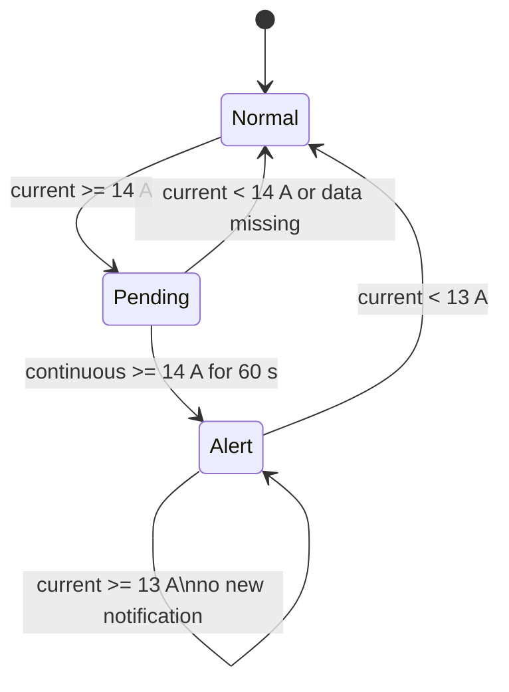

The 14 A/13 A hysteresis prevents repeated alerts around the threshold. A
successful alert is not repeated while its state is active. A failed Telegram
attempt is retried no earlier than five minutes later.

| Alert | Condition | Reset / deduplication |
|---|---|---|
| Phase consumption | phase ≥ 14 A for 60 s and positive phase power | rearmed below 13 A |
| Phase feed-in | phase ≥ 14 A for 60 s and negative phase power | rearmed below 13 A |
| Missing data | latest reading older than 60 s | reset when data is fresh |
| Daily limit | today's consumption ≥ configured kWh | at most once per local day |

Preferences and alert state are stored in `notifications.sqlite3` in the
`api-data` volume, so an API restart does not clear them.

## API

Every route requires:

```http
Authorization: Bearer <API_TOKEN>
```

Timestamps are ISO 8601 UTC. Database values are rounded to three decimal places
for JSON responses.

| Method | Route | Parameters | Purpose |
|---|---|---|---|
| `GET` | `/api/now` | – | latest reading, today, month, stale state |
| `GET` | `/api/series` | `hours=1..8784`, `points=10..1000` | downsampled history |
| `GET` | `/api/daily` | `days=1..3660` | daily total and per-phase use |
| `GET` | `/api/heatmap` | `days=7..3660` | average kWh by weekday/hour |
| `GET` | `/api/peaks` | `days=1..3660`, `limit=1..50` | one-minute peaks |
| `GET` | `/api/grid-load` | `days=1..30` | national load per 15 min |
| `PUT` | `/api/telegram/settings` | JSON body | notification preferences |
| `POST` | `/api/telegram/test` | – | send a test notification |

Example:

```bash
curl -s \
  -H "Authorization: Bearer <API_TOKEN>" \
  "http://127.0.0.1:8000/api/now"
```

Telegram settings example:

```bash
curl -s -X PUT \
  -H "Authorization: Bearer <API_TOKEN>" \
  -H "Content-Type: application/json" \
  -d '{
    "enabled": true,
    "phase_alerts": true,
    "stale_alerts": true,
    "daily_limit_kwh": 20,
    "pieter_mode": true
  }' \
  "http://127.0.0.1:8000/api/telegram/settings"
```

### Dutch national grid load

`/api/grid-load` uses the public
[Energy-Charts API](https://api.energy-charts.info/). The underlying Dutch data
comes from ENTSO-E/TenneT with the CC BY 4.0 attribution returned by the source.

- No dynamic energy contract is required.
- No personal Energy-Charts token is required.
- Each period has a 15-minute in-memory cache.
- A source failure returns an existing cache with `stale: true`.
- A source failure without a cache returns HTTP 502.

This is total Dutch electricity demand, not the local connection load and not an
electricity-price forecast.

## Data model and retention

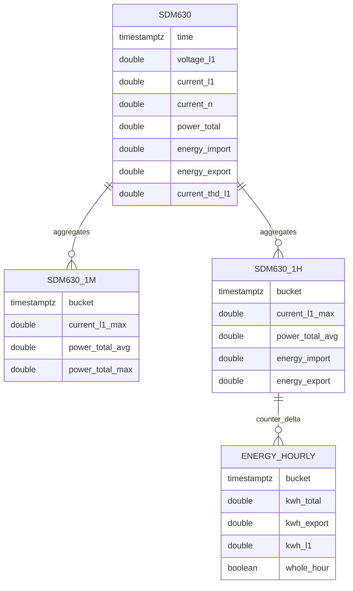

| Object | Grain | Contents | Retention |
|---|---:|---|---|
| `sdm630` | 5 s | all raw register measurements | 90 days |
| `sdm630_1m` | 1 min | averages and current/power peaks | unlimited |
| `sdm630_1h` | 1 hour | averages, peaks, latest counters | unlimited |
| `energy_hourly` | 1 hour | import/export and phase-import deltas | unlimited view |

Raw chunks are compressed after seven days. The minute aggregate refreshes each
minute with a six-hour lookback. The hour aggregate refreshes every thirty
minutes with a two-day lookback.

`whole_hour` is true only when consecutive readings are exactly one hour apart.
Incomplete periods count in totals but not in the hour/weekday heatmap. A
decreasing counter after meter replacement or reset is treated as zero using
`greatest(delta, 0)`.

### Measured registers

WattNu stores voltage on all phases; current on L1, L2, L3, and N; phase and
total power; frequency; total import/export; import per phase; and current THD
per phase.

Neutral current comes from protocol address `0x00E0` (register 30225). For
critical use, compare it with a suitable true-RMS clamp meter, especially with
non-linear loads.

## Security

### Trust boundaries

| Boundary | Control | Remaining risk |
|---|---|---|
| App → API | Tailscale HTTPS + Bearer token | one token, no user roles |
| API → database | read-only `grafana_ro` | password shared with Grafana |
| Grafana → database | read-only role | admin can read all data |
| Telegraf → meter | function code 04 only | Modbus has no authentication |
| API → Telegram | outbound HTTPS | bot token controls the bot |
| API → Energy-Charts | outbound HTTPS | external availability/quality |

Current controls include an unpublished database port, loopback-only API port,
constant-time token comparison, disabled OpenAPI documentation, disabled
Grafana signup, read-only query roles, secret-safe Telegram logging, ignored
`.env` files, and App Sandbox on macOS.

Recommended hardening:

- place the meter, gateway, and Pi on a trusted LAN or VLAN;
- expose Grafana only over the LAN or Tailscale;
- bind Grafana to loopback when direct LAN access is unnecessary;
- use unique long secrets and never share resolved Compose output;
- revoke leaked Telegram tokens immediately;
- keep encrypted, tested backups;
- consider Keychain instead of App Group `UserDefaults` for production tokens.

## Operations and maintenance

### Status and logs

```bash
docker compose ps
docker compose logs --tail 100 timescaledb
docker compose logs --tail 100 telegraf
docker compose logs --tail 100 api
docker compose logs --tail 100 grafana
```

### Update the API

```bash
git pull
docker compose up -d --build api
```

### Update the stack

```bash
git pull
docker compose pull
docker compose up -d --build
```

Consult official migration instructions before upgrading PostgreSQL or
TimescaleDB. A new image tag is not automatically a valid major-version upgrade
for an existing volume.

### Database backup

```bash
docker compose exec -T timescaledb \
  pg_dump -U energy -d energy -Fc > wattnu-$(date +%F).dump
```

Verify that the output is non-empty and periodically test a restore separately.

### Storage usage

```bash
docker system df
docker compose exec timescaledb \
  psql -U energy -d energy \
  -c "SELECT pg_size_pretty(total_bytes) AS total FROM hypertable_detailed_size('sdm630');"
```

### Grafana dashboard as code

The dashboard is provisioned from `grafana/dashboards/wattnu.json` with
`allowUiUpdates: false`, `disableDeletion: true`, datasource UID `wattnu-db`,
and dashboard title `WattNu`.

You can temporarily enable UI updates for experiments, but durable changes
should be written back to JSON so the repository remains the source of truth.

## Testing

### Server tests

```bash
cd WattServer
docker compose build api
docker run --rm --entrypoint python \
  -v "$PWD/api:/tests:ro" \
  -w /tests wattserver-api:latest \
  -m unittest discover -s tests -v
```

Tests cover flow direction, the continuous one-minute threshold, reset below
13 A, short-peak cancellation, notification deduplication, SQLite migration,
Telegram escaping/chat targeting, and grid-load parsing/caching.

### Swift builds without signing

```bash
xcodebuild \
  -project WattApp/WattNu.xcodeproj \
  -scheme WattNu \
  -sdk iphonesimulator \
  CODE_SIGNING_ALLOWED=NO build
```

```bash
xcodebuild \
  -project WattApp/WattNu.xcodeproj \
  -scheme WattNu \
  -sdk macosx \
  CODE_SIGNING_ALLOWED=NO build
```

## Troubleshooting

### Compose reports `variable is not set`

A password probably contains `$`. Wrap it in single quotes:

```dotenv
GRAFANA_DB_PASSWORD='value-containing-$-characters'
```

```bash
docker compose config --quiet
docker compose up -d --force-recreate api grafana
```

### API reports `PoolTimeout`

```bash
docker compose ps
docker compose logs --tail 100 timescaledb
docker compose logs --tail 100 api
docker compose exec timescaledb \
  psql -U energy -d energy \
  -c "SELECT rolname, rolcanlogin FROM pg_roles WHERE rolname = 'grafana_ro';"
```

If the role is missing, the init scripts were not rerun for the existing
volume. Recreate the role deliberately; do not delete useful history.

### `relation sdm630_1h does not exist`

Schema initialisation did not complete. Inspect the first database error, not
only the last follow-up error. A full reset is suitable only for a disposable
test environment. Back up valuable history before repairing a schema.

### API starts before the database

Brief `database system is starting up` messages can occur during recovery. The
health check and restart policy should stabilise the stack. Persistent password
errors indicate role/configuration mismatch, not an underpowered Pi.

### Missing cgroup file during Timescale tuning

Compose sets `NO_TS_TUNE: "true"`, preventing automatic tuning from relying on
cgroup files that may be absent on some Pi installations.

### No meter data

```bash
docker compose run --rm check
docker compose logs --tail 100 telegraf
```

Also verify Pi time and DR302 reachability from the Docker host network.

### Telegram: `chat not found`

- Send the bot a message first.
- Retrieve `getUpdates` afterwards.
- Use `message.chat.id`, not the bot ID.
- Rebuild the API after changing `.env`.

### Telegram: `the bot can't send messages to the bot`

The configured ID belongs to the bot itself. Replace it with the conversation
ID between your Telegram account and the bot.

### WattApp reports `401`

The app token does not exactly match `API_TOKEN`. Check whitespace and recreate
the API after changing it:

```bash
docker compose up -d --force-recreate api
```

### WattApp cannot reach the API

```bash
tailscale serve status
curl -s -o /dev/null -w '%{http_code}\n' \
  -H "Authorization: Bearer <API_TOKEN>" \
  https://<host>.<tailnet>.ts.net/api/now
```

Both devices must be in the same tailnet. Do not add a second `/api` path to the
server address in WattApp.

### Complete test-environment reset

> [!CAUTION]
> This permanently removes database, Grafana, and notification volumes. Use it
> only when all history may be deleted and a usable backup exists.

```bash
docker compose down -v
docker compose up -d --build
```

## Known limitations

- WattNu is a personal project, not a certified safety or billing system.
- The API uses one shared Bearer token and has no user management.
- The app token is stored in App Group preferences, not Keychain.
- Telegram does not replace electrical protection.
- Grid load depends on Energy-Charts/ENTSO-E/TenneT and may be delayed.
- The in-memory grid cache is lost when the API restarts.
- THD is stored but not yet shown in WattApp.
- Export is stored, but daily/monthly cards currently show imported energy.
- Grafana listens on all host interfaces on port 3000 in the current Compose
  configuration.
- Database initialisation is not a migration system.
- Screenshots may be slightly behind the latest tab layout.

## Possible next steps

- Keychain storage and token rotation;
- versioned database migrations;
- configurable alert thresholds and hold times;
- voltage, frequency, and THD alerts;
- export and feed-in reporting;
- price data for dynamic energy contracts;
- automated backups and restore tests;
- container health and metrics endpoints;
- CI for Python tests and Apple-platform builds;
- improved accessibility and localisation;
- automatically refreshed release screenshots.

## Technology and references

- [Eastron SDM630](https://www.eastroneurope.com/products/view/sdm630modbus)
- [Telegraf Modbus input](https://github.com/influxdata/telegraf/tree/master/plugins/inputs/modbus)
- [TimescaleDB](https://docs.timescale.com/)
- [Grafana](https://grafana.com/docs/grafana/latest/)
- [FastAPI](https://fastapi.tiangolo.com/)
- [Tailscale Serve](https://tailscale.com/docs/reference/tailscale-cli/serve)
- [Energy-Charts API](https://api.energy-charts.info/)
- [Telegram Bot API](https://core.telegram.org/bots/api)
- [SwiftUI](https://developer.apple.com/xcode/swiftui/)
- [Swift Charts](https://developer.apple.com/documentation/charts)

## Licence

This repository currently has no separate `LICENSE` file. Add an explicit
licence before inviting public reuse; without one, reuse rights are not granted
automatically.

---

**WattNu** — measuring is knowing, and charts are just opinions with a legend.
